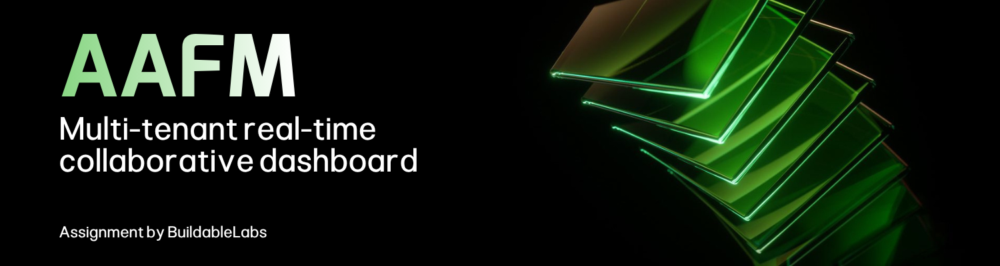
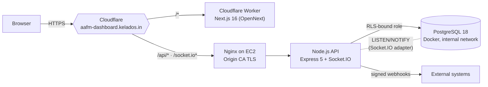

<p align="center">
  
</p>

<p align="center">
  <b>A hierarchical multi-tenant analytics dashboard with real-time collaboration.</b><br/>
  Organizations → Teams → Projects, each seeing only their own data, editing dashboards together live.
</p>

<p align="center">
  <a href="https://aafm-dashboard.kelados.in"><b>Live demo</b></a> ·
  <a href="#architecture">Architecture</a> ·
  <a href="#security">Security</a> ·
  <a href="#running-locally">Run locally</a> ·
  <a href="#testing">Testing</a> ·
  <a href="prompt-book.md">Prompt history</a>
</p>

---

## Live demo

**https://aafm-dashboard.kelados.in**. Sign in with organization `acme` and password `Password@123`:

| Email | Role | Sees |
|---|---|---|
| `super@acme.test` | Super Admin | The whole organization |
| `alice@acme.test` | Admin of Finance, Viewer in Marketing | Switch teams after sign-in |
| `bob@acme.test` | Editor in Finance | Finance only |
| `carol@acme.test` | Viewer in Marketing | Marketing only, read-only |
| `dave@acme.test` | Admin of Marketing | Marketing only |

Open the same dashboard as Bob and Alice (Finance) in two browsers to see live co-editing and presence. The live data ticks every 15 seconds.

## What it does

| Tier | Feature | How |
|---|---|---|
| **1** | Org → Team hierarchy, Admin / Editor / Viewer roles | A Super Admin per organization; users can hold different roles in different teams |
| | Dashboards with drag-and-drop widgets | Line, bar and number widgets on a 12-column grid |
| | Data isolation | **PostgreSQL row-level security**: the database itself refuses cross-team reads and writes |
| **2** | Simultaneous editing, real-time sync | Socket.IO rooms; presence, live edits and optimistic concurrency (no silent overwrites) |
| | Real-time metrics | A simulator writes live points; every chart and total follows them |
| | KPI calculations | ARPU = Revenue ÷ Active users, CTR, error rate, computed as ratios of sums |
| | Anomaly detection | Each metric is compared with its own last hour (2σ); alerts open and resolve on their own |
| **3** | Org → Team → **Project** | Projects own the data; team totals are the sum of their projects |
| | Webhook subscriptions | Signed per the Standard Webhooks spec, with retries, an SSRF guard and encrypted secrets |
| | Audit logs | Who did and opened what. Append-only and hash-chained, with signed checkpoints; older entries are compressed but kept |
| | Custom metric definitions | Formulas like `(clicks - errors) / page_views * 100`, safely parsed, usable in any widget |

## Architecture



- **One origin.** Cloudflare sends pages to the Worker and `/api` and `/socket.io` to EC2, so the session cookie stays first-party (`__Host-`, `HttpOnly`, `Secure`, `SameSite=Strict`) and needs no CORS.
- **Database-enforced tenancy.**
  - Every request runs in a transaction as a restricted role (no superuser, no BYPASSRLS), with the user, organization and team set transaction-locally.
  - Row-level security policies decide what each statement can see or change.
- **Background jobs** (live-metric simulator, anomaly detection, webhook delivery, housekeeping) are safe to run on several instances (database claims and `SKIP LOCKED`). They run inside the API or as a separate `npm run worker`.

## Security

- **Isolation:** forced row-level security on every tenant table; composite foreign keys pin rows to their own team and project. Cross-team access returns 404, not 403, so nothing is revealed.
- **Accounts:**
  - organization-scoped accounts (AWS IAM style), one-time passwords with a forced change, and scrypt hashing;
  - an identical answer and timing for unknown users;
  - account lockout plus per-IP and per-session rate limits.
- **Sessions:**
  - server-side, with only a SHA-256 of the token stored;
  - 30 min idle / 8 h absolute limits, and a new ID on every privilege change;
  - live sockets close immediately on sign-out, removal or a password change.
- **Requests:**
  - a CSRF header check, strict input validation (zod) and size limits;
  - idempotency keys on creates;
  - database time limits, and request IDs from edge to audit log;
  - a Content Security Policy.
- **Webhooks:**
  - HMAC-SHA256 signatures (Standard Webhooks), with secrets encrypted with AES-256-GCM and keys kept outside the database;
  - SSRF protection that checks every resolved address at connect time and never follows redirects.
- **Audit log:**
  - append-only, enforced in the database;
  - a SHA-256 hash chain plus HMAC-signed checkpoints detect edited or deleted entries;
  - **Verify integrity** in the UI.

Details: [`docs/edge-case-audit.md`](docs/edge-case-audit.md) (25 production edge cases, all fixed and tested).

## Tech stack

| Layer | Choice |
|---|---|
| Frontend | Next.js 16 (App Router), React 19, TypeScript, Tailwind CSS v4, react-grid-layout, Socket.IO client |
| Backend | Node.js 24, Express 5, Socket.IO 4.8 with the Postgres adapter, zod, raw SQL via `pg` (no ORM) |
| Database | PostgreSQL 18: row-level security, PL/pgSQL, LZ4-compressed audit archive |
| Hosting | Cloudflare Workers (frontend), AWS EC2 with Docker Compose and Nginx (API and database) |

## Repository layout

```
backend/    Express API, Socket.IO, background jobs, SQL migrations, tests, Postman collection
frontend/   Next.js app (Cloudflare Worker build via OpenNext)
deploy/     Docker Compose, Nginx config, backup and Cloudflare-IP scripts for EC2
docs/       Plans, test checklists, design decisions, edge-case audit, deployment runbook
prompt-book.md   Every prompt given during development, in order
problems-log.md  Every problem found, who found it, how it was fixed and verified
```

## Running locally

Requirements: Node.js 24 and PostgreSQL 18 (a superuser for migrations).

```bash
# Backend
cd backend
cp .env.sample .env          # set DATABASE_URL, MIGRATION_DATABASE_URL, APP_DB_PASSWORD, CORS_ORIGIN
npm install
npm run keyring -- init      # webhook secret encryption key (backend/secrets/, git-ignored)
npm run migrate && npm run seed
npm run dev                  # http://localhost:8000

# Frontend (second terminal)
cd frontend
cp .env.sample .env.local    # BACKEND_URL, NEXT_PUBLIC_SOCKET_URL=http://localhost:8000
npm install
npm run dev                  # http://localhost:3000
```

## Testing

| Suite | What | Result |
|---|---|---|
| `backend: npm test` | Real HTTP, real sockets, real database: isolation, roles, real-time, KPIs, anomalies, projects, audit, custom metrics, webhooks, hardening, notifications, audit search, chat webhooks, shared data, completed projects, plus unit tests | **140 / 140** |
| Postman | `backend/aafm-dashboard.postman_collection.json`, 132 requests across all tiers, security checks and the new features | 101 requests verified (131 assertions); folder 10 (31 requests) awaits its first run |
| Frontend | `npm run typecheck && npm run lint && npm run build` | clean |
| Manual | Step-by-step checklists in `docs/tier-*-test-checklist.md` and `docs/features-test-checklist.md` | Run and signed off by me (Tiers 1–2 done) |

## Deployment

The full runbook is [`docs/deployment-plan.md`](docs/deployment-plan.md):
- **EC2:** Docker Compose runs Postgres 18 (internal network only), the API and Nginx. Nginx trusts client IPs only from Cloudflare, and port 443 is reachable only from Cloudflare.
- **Frontend:** `npm run deploy` in `frontend/` (OpenNext → Cloudflare Workers).
- **Operations:** nightly `pg_dump` backups; the webhook keyring and the server `.env` never leave the server.

## How it was built

I built this project with the help of Claude as a coding assistant, working under rules I set ([`CLAUDE.md`](CLAUDE.md)):
- every feature backed by research with sources;
- no assumptions: open questions come back to me before any work starts;
- every problem logged;
- nothing committed or deployed without my approval.

**Testing and review.** Every change was tested and reviewed by me before it was accepted. I reviewed every UI change myself, worked through each tier's test checklist by hand, ran the automated suites and Postman, and decided what was committed and deployed.

The complete prompt history is in [`prompt-book.md`](prompt-book.md), and every issue found along the way is in [`problems-log.md`](problems-log.md).

---

<sub>Assignment by BuildableLabs: Hierarchical Multi-Tenant Analytics Dashboard with Collaboration.</sub>
